# Proyecto API - Deadlock Heroes

Aplicación JavaFX para consultar, sincronizar, buscar y exportar información de
héroes de Deadlock. La aplicación consume la API pública
`https://api.deadlock-api.com/v1/assets/heroes` y guarda los datos recibidos en
una base de datos MySQL.

## 1. Introducción al supuesto

El supuesto consiste en desarrollar una aplicación de escritorio que permita
consultar información estructurada de los héroes de Deadlock. Al iniciar la
aplicación, el usuario debe autenticarse. Después, se consulta la API externa,
se sincronizan los héroes con MySQL y se muestran en tarjetas.

Las funcionalidades principales son:

- Inicio de sesión y registro de usuarios.
- Almacenamiento seguro de contraseñas mediante PBKDF2 con salt aleatorio.
- Sincronización de héroes desde una API externa.
- Persistencia de héroes, descripciones y etiquetas.
- Búsqueda por nombre, nombre interno, tipo, clase o tags.
- Exportación de héroes a CSV o JSON.

### Descripción de la API

La aplicación utiliza el siguiente recurso:

| Método | URL                                                            | Descripción                                                                 |
|--------|----------------------------------------------------------------|-----------------------------------------------------------------------------|
| `GET`  | `https://api.deadlock-api.com/v1/assets/heroes`                | Devuelve la lista de héroes en formato JSON. `Unico realmente usando.`      |
| `GET`  | `https://api.deadlock-api.com/v1/assets/heroes/{hero_id}`      | Devuelve el héroe en formato JSON buscando por el id.                       |
| `GET`  | `https://api.deadlock-api.com/v1/assets/heroes/by-name/{name}` | Devuelve el héroe en formato JSON buscando por el nombre.                   |
| `GET`  | `https://api.deadlock-api.com/v1/assets/items`                 | Devuelve la lista de los items en formato JSON.                             |
| `GET`  | `https://api.deadlock-api.com/v1/assets/items/by-hero-id/{id}` | Devuelve la lista de los item en formato JSON filtrando por el id del hero. |

La petición incluye la cabecera `Accept: application/json`, tiene un tiempo
máximo de conexión de 15 segundos y un timeout de respuesta de 30 segundos.
Solo se aceptan respuestas HTTP 2xx. Cada objeto recibido se transforma en un
modelo `Hero` y se inserta o actualiza en la base de datos.

### Capturas de Postman

1. Petición `GET /v1/assets/heroes`:
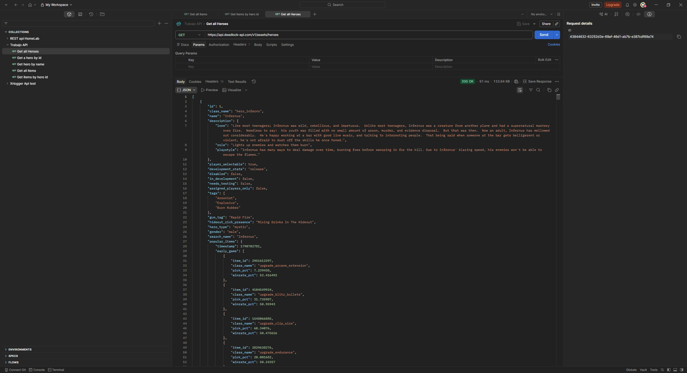


2. Petición `GET /v1/assets/heroes/{hero_id}`:


3. Petición `GET /v1/assets/heroes/by-name/{name}`:
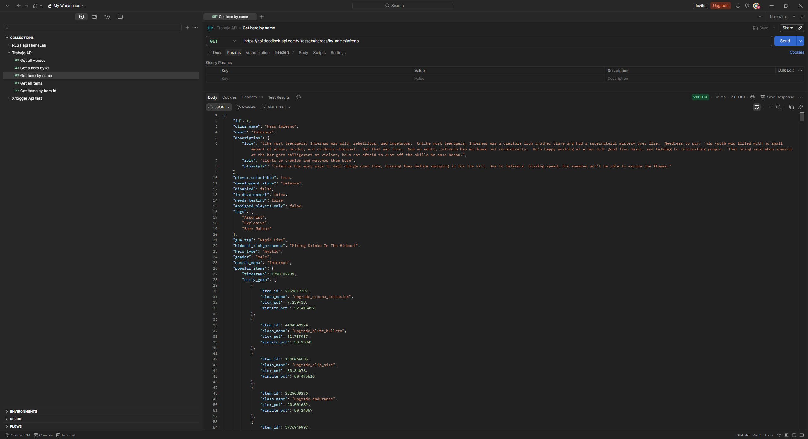


4. Petición `GET /v1/assets/items`:
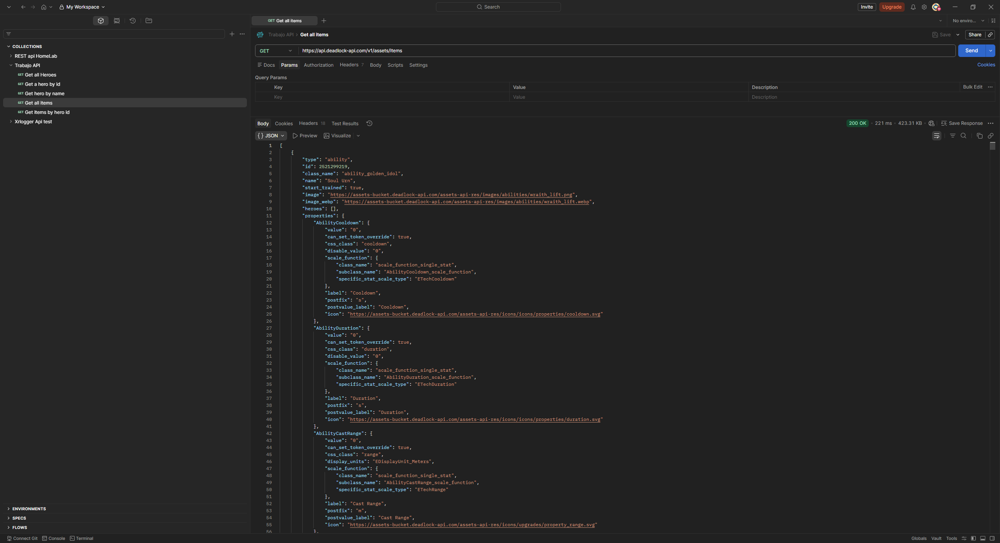


5. Petición `GET /v1/assets/items/by-hero-id/{id}`:
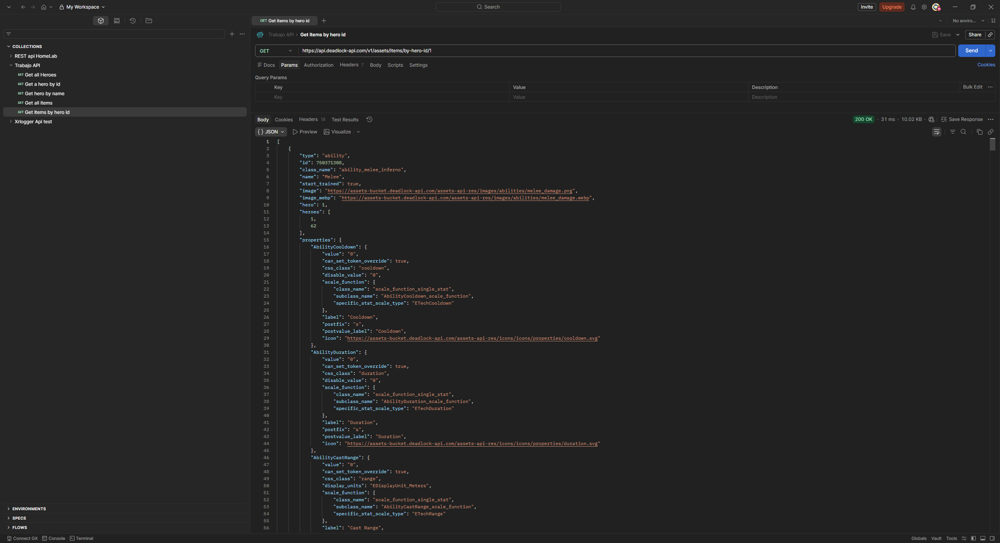

## 2. Diagrama ER Crowfoot de la base de datos

El siguiente diagrama representa las tablas creadas en
[`tools/db/script.sql`](tools/db/script.sql):

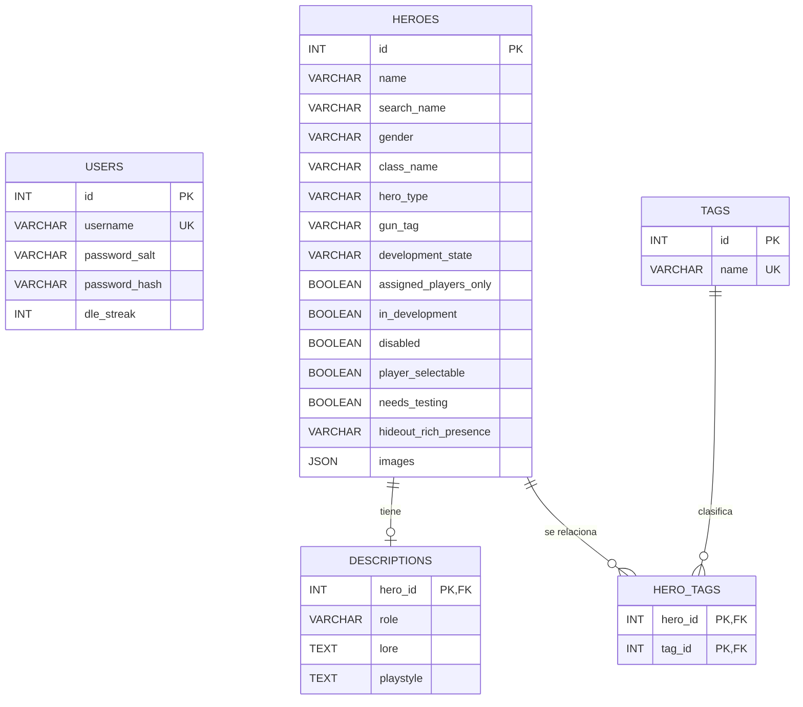

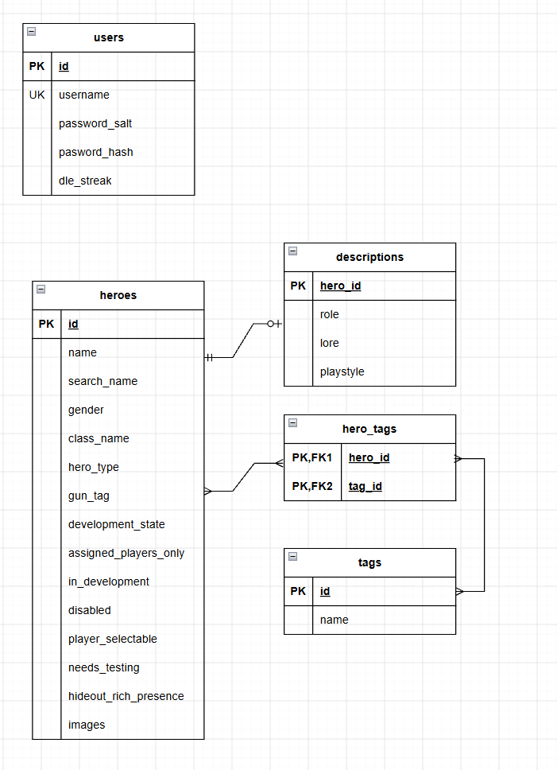

### Relaciones

- `heroes` y `descriptions`: relación 1:0..1. Una descripción pertenece a un
  único héroe y se elimina en cascada al borrar el héroe.
- `heroes` y `tags`: relación N:M mediante `hero_tags`.
- `users` es independiente de los datos de héroes y contiene las credenciales
  necesarias para acceder a la aplicación.

## 3. Manual técnico para desarrolladores

<video controls width="800">
  <source src="docs/manualTecnico.mp4" type="video/mp4">
  Tu navegador no permite reproducir vídeos HTML5.
  <a href="docs/manualTecnico.mp4">Abrir el manual técnico en formato MP4</a>
</video>

[Link al videomanual](/docs/manualTecnico.mp4)

### Requisitos

- JDK 25.
- Maven.
- Docker y Docker Compose.
- MySQL compatible con MySQL Connector/J 9.2.

### Puesta en marcha

1. Clonar el repositorio.
2. Iniciar MySQL desde la carpeta `tools/db`:

   ```bash
   docker compose up -d
   ```

3. Revisar la configuración en
   [`src/main/resources/config.properties`](src/main/resources/config.properties):

   ```properties
   database.url=jdbc:mysql://localhost:3307/deadlock
   database.user=root
   database.password=abc123
   ```

4. Para una instalación inicial, las tablas deberian crearse automáticamente y los datos deberían obtenerse directamente de la API. Si no es así, ejecutar
   [`tools/db/script.sql`](tools/db/script.sql) en MySQL Workbench o desde la
   línea de comandos.


5. Compilar y ejecutar:

   ```bash
   mvn clean javafx:run
   ```

   Este comando compila el proyecto y añade automáticamente al
   `module-path` las dependencias de JavaFX, SLF4J, Jackson, MySQL y el resto
   de librerías necesarias. Desde un IDE también se puede ejecutar la clase
   `org.example.Main` con las dependencias de Maven configuradas.

### Arquitectura

La aplicación sigue una arquitectura por capas, separando la interfaz, la
lógica de negocio, el acceso a datos y los modelos:

```text
┌─────────────────────────────────────────────────────────────┐
│ Interfaz JavaFX                                             │
│ Main + Login.fxml + HeroCardsView.fxml + HeroCard.fxml      │
│ LoginController + HeroCardsViewController + HeroCardController│
└──────────────────────────────┬──────────────────────────────┘
                               │
┌──────────────────────────────▼──────────────────────────────┐
│ Servicios                                                   │
│ AuthService · HeroSyncService · HeroService                 │
│ CsvExportService · JsonExportService                        │
└───────────────┬──────────────────────────┬──────────────────┘
                │                          │
┌───────────────▼──────────────┐  ┌────────▼──────────────────┐
│ Repositorios                  │  │ API externa              │
│ HeroRepository               │  │ GET /v1/assets/heroes    │
│ DescriptionRepository        │  │ JSON de héroes            │
│ TagRepository                │  └───────────────────────────┘
│ HeroTagRepository            │
└───────────────┬──────────────┘
                │
┌───────────────▼─────────────────────────────────────────────┐
│ Persistencia                                                 │
│ DatabaseManager · DatabaseService · MySQL                   │
│ users · heroes · descriptions · tags · hero_tags            │
└─────────────────────────────────────────────────────────────┘
```

#### Capas y responsabilidades

- **Arranque y presentación**: `Main` inicia JavaFX, carga `Login.fxml` y
  cambia a `HeroCardsView.fxml` cuando el login es correcto. Los controladores
  reciben los eventos de los botones, validan los formularios y actualizan la
  interfaz.
- **Servicios**: `AuthService` registra y autentica usuarios usando PBKDF2.
  `HeroSyncService` realiza la petición HTTP, valida el código de respuesta,
  convierte el JSON a objetos `Hero` y coordina la persistencia. La
  sincronización se ejecuta en segundo plano mediante una tarea JavaFX para no
  bloquear el hilo de la interfaz. `HeroService` contiene operaciones de
  consulta sobre la colección cargada. Los servicios de exportación generan
  los ficheros CSV y JSON.
- **Repositorios**: encapsulan las consultas SQL de cada agregado. `HeroRepository`
  gestiona los héroes, mientras que los repositorios de descripciones, tags y
  relaciones mantienen las tablas asociadas.
- **Acceso a datos**: `DatabaseManager` define las operaciones parametrizadas
  (`select`, `insert`, `update` y `delete`). `DatabaseService` mantiene la
  conexión MySQL y ejecuta las consultas mediante `PreparedStatement`.
- **Modelos**: `Hero`, `Description` y `Response` representan los datos
  recibidos de la API y los objetos que se muestran en la aplicación.
- **Configuración y recursos**: `Config` carga la conexión desde
  `config.properties`; los ficheros FXML describen la interfaz, y Logback
  gestiona el registro de errores y eventos.

#### Flujo de ejecución

1. `Main` crea la ventana y carga `Login.fxml`.
2. Al iniciar la aplicación, `Main` lanza la sincronización de héroes en un
   `Task<Integer>` ejecutado por el hilo daemon
   `hero-api-synchronization`. La ventana de login sigue disponible mientras
   se realiza la petición y la persistencia.
3. El usuario inicia sesión o se registra desde `LoginController`.
4. `AuthService` consulta la tabla `users`; al registrar, genera un salt y
   guarda el hash PBKDF2, nunca la contraseña en texto plano.
5. Después de autenticarse, `Main` carga la lista existente desde MySQL y
   muestra `HeroCardsView.fxml`; no necesita esperar a que termine la
   sincronización asíncrona.
6. El `Task` ejecuta `HeroSyncService`, que hace un `GET` a la API pública y
   deserializa la respuesta JSON con Jackson.
7. Para cada héroe, `HeroRepository` decide si debe insertarlo o actualizarlo.
   También se persisten su descripción, tags e imágenes.
8. Cuando la tarea termina correctamente, su callback se ejecuta en el hilo de
   JavaFX, registra el número de héroes sincronizados y recarga la lista en
   `HeroCardsViewController`. Si falla, se registra la excepción sin cerrar
   inesperadamente la interfaz.
9. `HeroCardsViewController` permite filtrar por los campos seleccionados.
10. El usuario puede exportar la lista a CSV o JSON mediante
   `CsvExportService` y `JsonExportService`.

#### Dependencias externas

- **JavaFX**: ventanas, controles, eventos y carga de FXML.
- **MySQL Connector/J**: conexión JDBC con MySQL.
- **Jackson**: deserialización y serialización JSON.
- **SLF4J y Logback**: logging de la aplicación.
- **API Deadlock**: fuente remota de los datos de héroes.

## 4. Manual de usuario y juego de pruebas

### Uso de la aplicación

1. Iniciar la aplicación.
2. Introducir usuario y contraseña y pulsar **Entrar**.
3. Para crear una cuenta, pulsar **Registrarse**. Los campos se limpian y
   aparece la confirmación de contraseña.
4. Introducir usuario, contraseña y confirmación; pulsar **Crear cuenta**.
5. Volver al formulario de login e iniciar sesión.
6. Esperar a que se sincronicen los héroes.
7. Utilizar el selector y el buscador para filtrar resultados.
8. Pulsar **Exportar** y elegir CSV o JSON.

### Juego de pruebas

| ID  | Prueba                | Pasos                                                             | Resultado esperado                                                |
|-----|-----------------------|-------------------------------------------------------------------|-------------------------------------------------------------------|
| P01 | Login correcto        | Introducir credenciales válidas y pulsar Entrar                   | Se abre la pantalla de héroes                                     |
| P02 | Login incorrecto      | Introducir una contraseña incorrecta                              | Se muestra un error y se limpia la contraseña                     |
| P03 | Registro correcto     | Pulsar Registrarse, completar dos contraseñas iguales y registrar | Se crea la cuenta y se vuelve al login                            |
| P04 | Contraseñas distintas | Registrar con dos contraseñas diferentes                          | Se muestra “Las contraseñas no coinciden”                         |
| P05 | Usuario duplicado     | Registrar un usuario ya existente                                 | Se informa de que el usuario ya está registrado                   |
| P06 | Campos vacíos         | Registrar sin usuario o contraseña                                | Se muestra un error de validación                                 |
| P07 | Búsqueda              | Buscar por nombre, clase o tag                                    | Solo aparecen las tarjetas coincidentes                           |
| P08 | Sin resultados        | Buscar un texto inexistente                                       | No aparecen tarjetas                                              |
| P09 | Exportación CSV       | Pulsar Exportar y elegir CSV                                      | Se genera un fichero CSV legible                                  |
| P10 | Exportación JSON      | Pulsar Exportar y elegir JSON                                     | Se genera un fichero JSON válido                                  |
| P11 | Sin API disponible    | Detener la conexión o usar una API no disponible                  | Se registra el error y la aplicación no se cierra inesperadamente |

### Capturas de usuario

#### PO1 - Login correcto

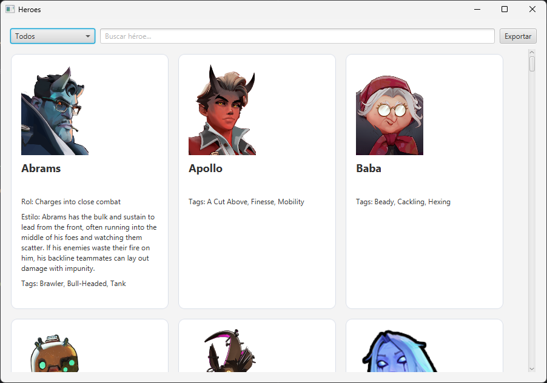

#### PO2 - Contraseña incorrecta

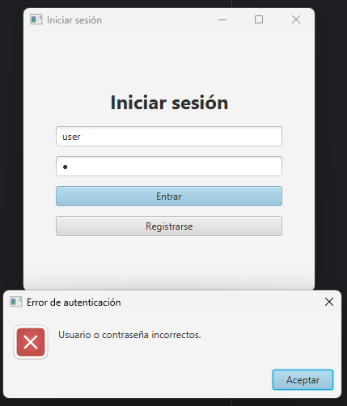

#### PO3 - Registro de usuario

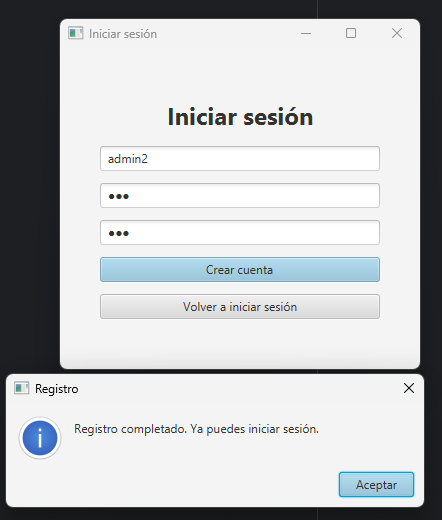

#### PO4 - Contraseñas distintas

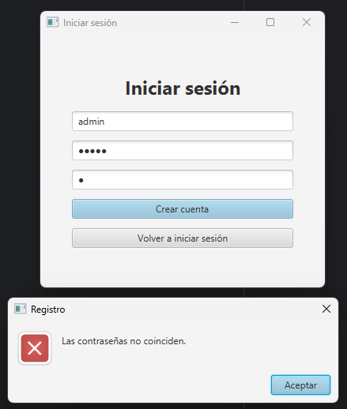

#### PO5 - Usuario duplicado

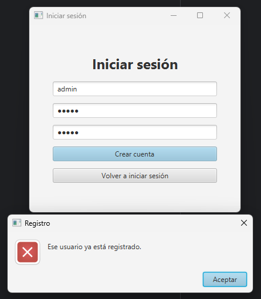

#### PO6 - Búsqueda de héroes

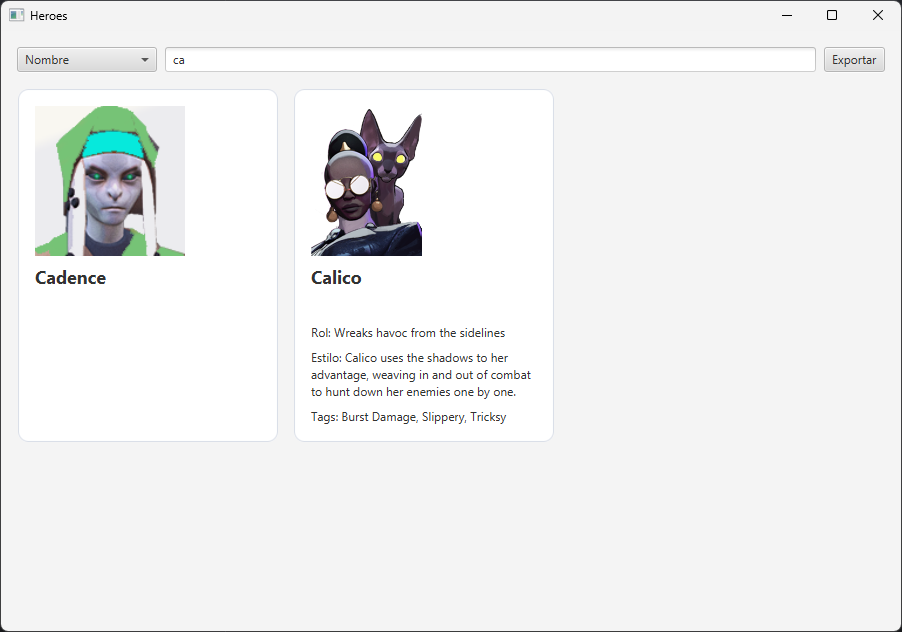

#### PO7 - Exportación CSV

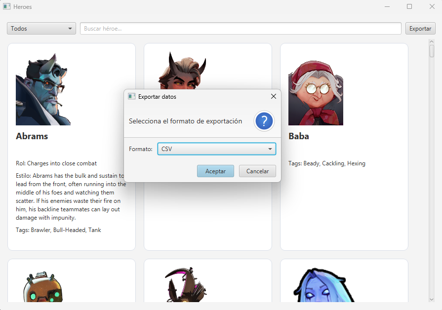

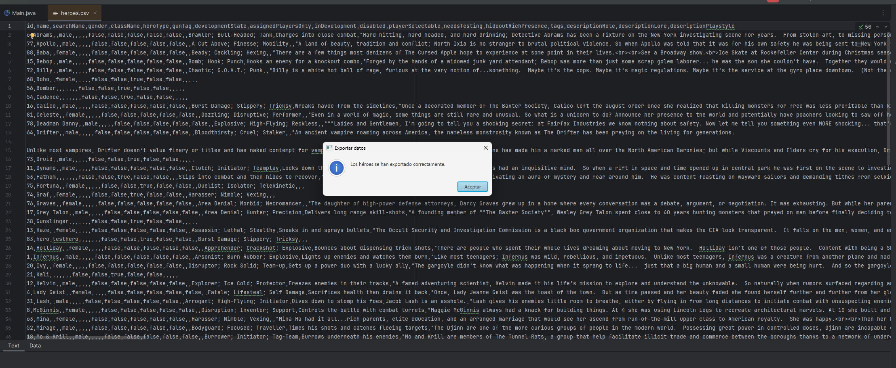

#### PO8 - Exportación JSON

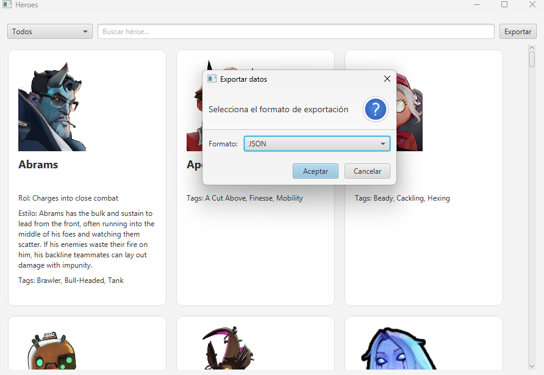

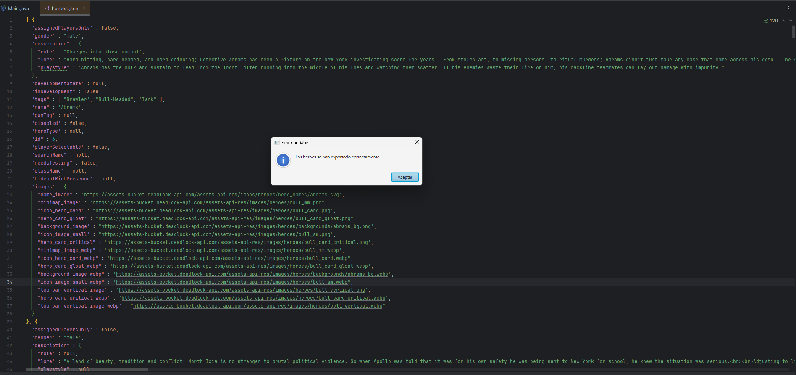

